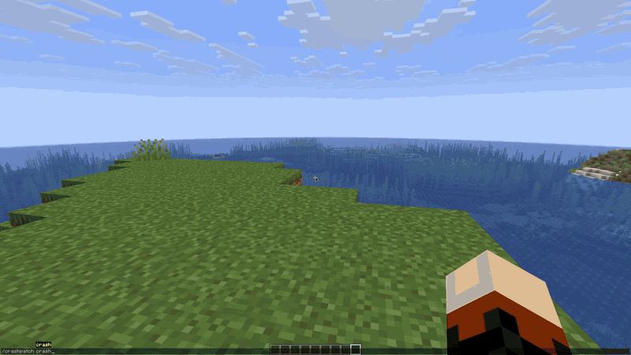
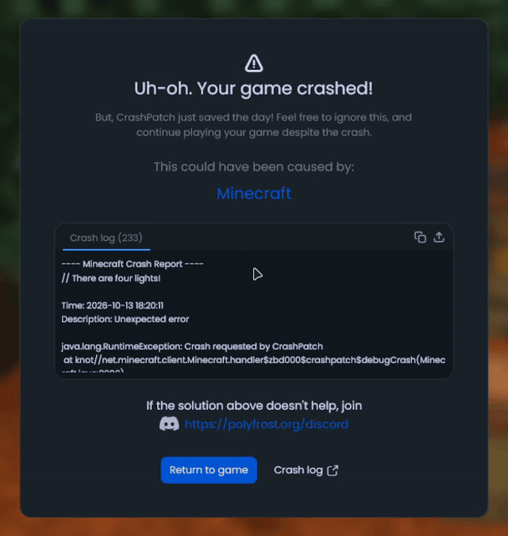
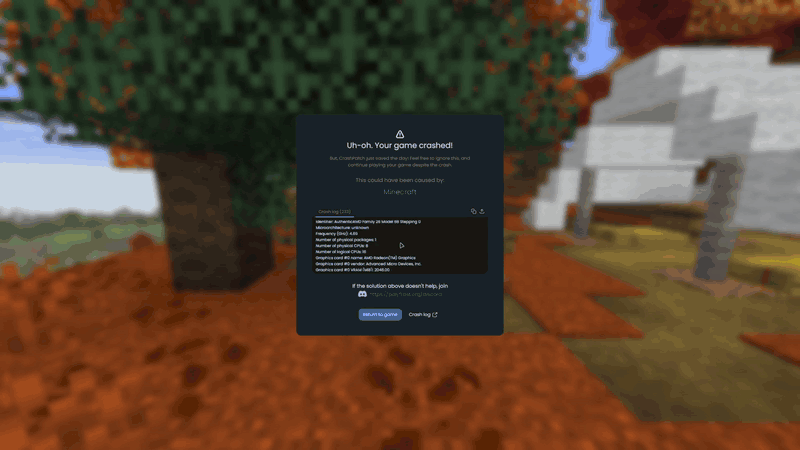

# CrashPatch

CrashPatch stops a crash from closing your game. You get a screen that tells you which mod probably caused it and how to fix it, and most of the time you can just keep playing.

- See which mod is suspected
- Get known fixes for the crash
- Read the full crash log, copy it or upload it to hst.sh or mclo.gs (your session token is stripped out first)
- Go back to the game with one button

If the game crashes while it is still starting up there's nothing to go back to, but you still get the same screen with the cause and the fixes.

Other things it does:

- Disconnect screens show a fix when the reason is one CrashPatch knows
- Failed mixins and packet errors from before the crash are added to the report
- `/crashpatch crash` crashes the game on purpose (if you want to see the screen)
- On 1.8.9, set how many crashes it takes before you are sent out of the world or the game is allowed to close

## Supported versions

- Minecraft 1.8.9 on Ornithe.
- Minecraft 1.21.1-26.3 on Fabric.

CrashPatch needs [OneConfig](https://modrinth.com/mod/oneconfig) and Fabric Language Kotlin. The Fabric builds also need [Not Enough Crashes](https://modrinth.com/mod/notenoughcrashes).

## Support

- Report bugs and ask questions on the [Polyfrost Discord](https://polyfrost.org/discord).
- Check [Polyfrost Status](https://status.polyfrost.org/) if a Polyfrost service is down.
